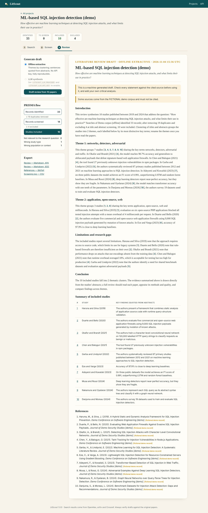
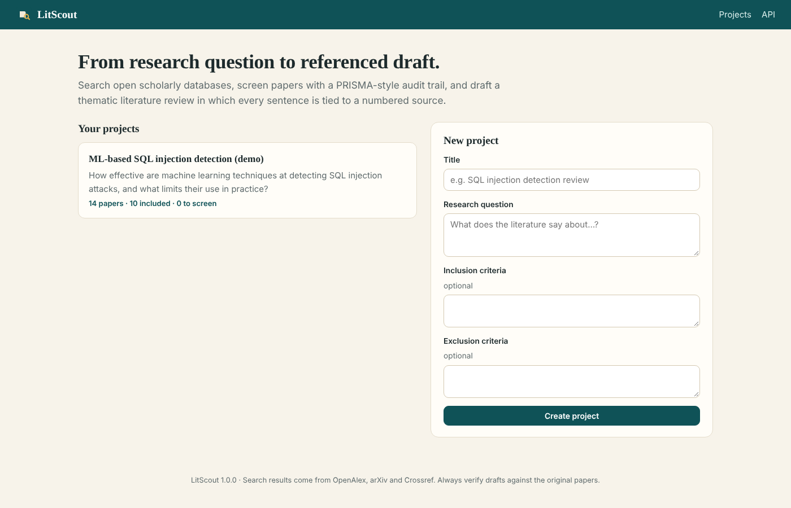
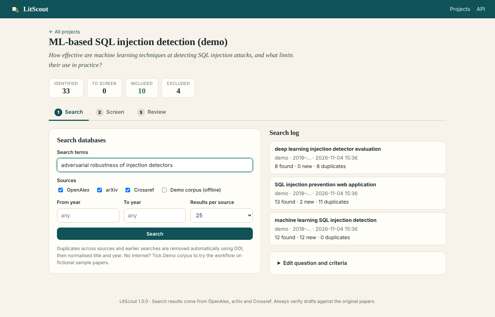
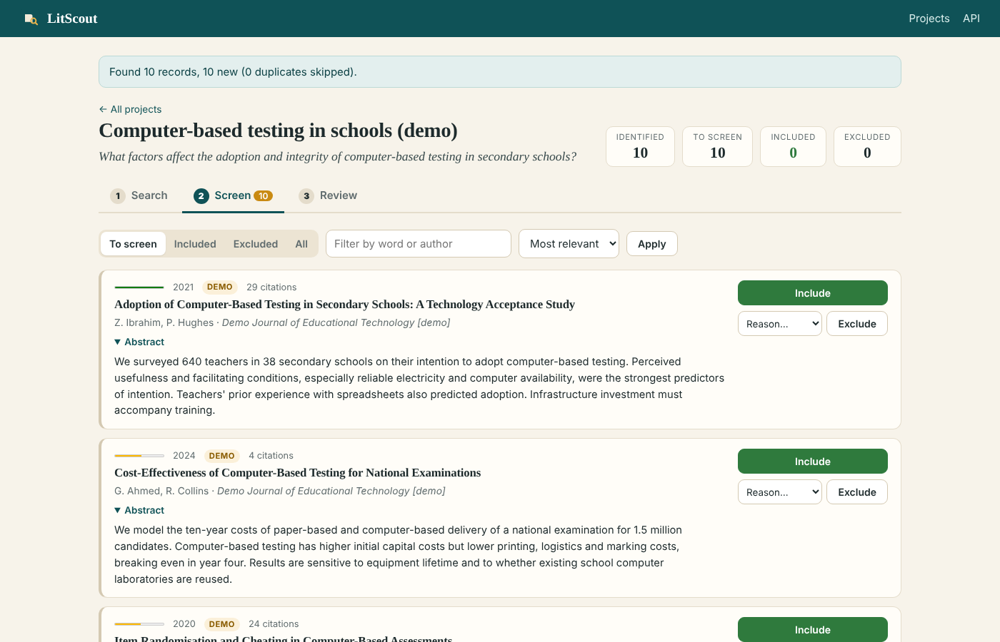
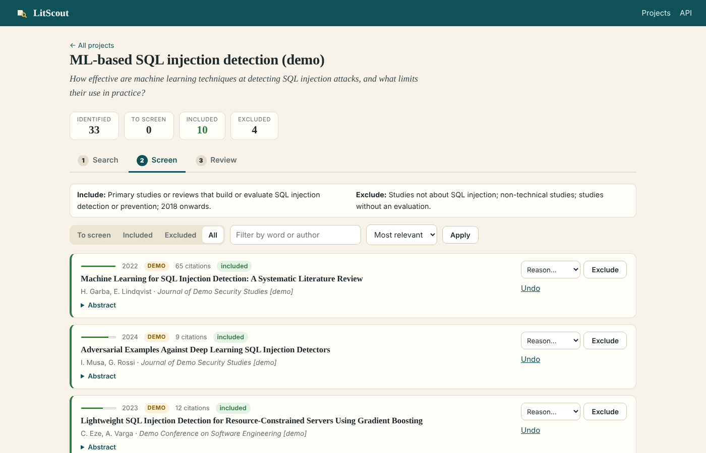

# LitScout: an AI-assisted literature review assistant

LitScout takes a research question to a **referenced first draft of a literature review**. It searches open scholarly databases, removes duplicates, and supports title and abstract screening with a PRISMA-style audit trail. It then drafts a thematic review in which **every statement is tied to a numbered source you can check**.

It is built for students, researchers and research supervisors doing systematic or narrative reviews, especially where paid tools are out of reach. The core works **without an API key**, and an LLM can be plugged in for abstractive synthesis.

**Stack:** Python 3.11+ · FastAPI · LangGraph · Jinja2 · SQLite (with a vector store table) · httpx · pytest + respx · Docker · GitHub Actions · Google Cloud Run




## The problem

Early-stage reviews are slow. You search several databases with different interfaces, merge results by hand and lose track of duplicates. The reasons for excluding papers go unrecorded, and a summary has to be written from dozens of abstracts. Generic AI chatbots speed up the writing but often **invent references**. That is unacceptable in academic work.

LitScout's design rule: **the software may summarise, but it may not invent.**

## How it works

| Step | What LitScout does |
|---|---|
| **1. Search** | Queries **OpenAlex**, **arXiv** and **Crossref** in one go, with year filters. Each source runs independently, so one failing service never loses the others' results. |
| **2. De-duplicate** | Matches records by DOI, then by normalised title and year, across sources and across repeated searches. The counts feed the PRISMA flow. |
| **3. Rank** | Scores every paper against your research question and search history with BM25, so the most relevant papers are screened first. With an embedding model configured, ranking becomes **hybrid**: BM25 plus vector similarity, fused with Reciprocal Rank Fusion. |
| **4. Screen** | Include or exclude each paper, recording a reason for each exclusion. Filter, sort, and undo decisions. Export the full screening log as CSV. |
| **5. Draft** | A LangGraph pipeline (retrieve → draft → verify citations → redraft if needed) generates a review: introduction with search statistics, thematic sections, limitations and gaps, conclusion, a summary-of-studies table and a reference list. |
| **6. Export** | Markdown (APA or IEEE references), BibTeX for Zotero, Mendeley or LaTeX, and the screening CSV. |

### Hybrid retrieval (RAG)

Keyword ranking misses papers that use different words for the same idea ("SQLi" vs "SQL injection"). When
`LITSCOUT_EMBED_PROVIDER` is set, LitScout:

1. Embeds each paper's title and abstract through any OpenAI-compatible `/embeddings` endpoint (OpenAI, or a free local
   model such as `nomic-embed-text` on Ollama).
2. Stores the unit vectors in an `embeddings` table in SQLite, cached per paper and per model, so each paper is
   embedded once and the vectors are deleted with their project.
3. Ranks papers by BM25 and by cosine similarity to the query, then fuses the two rankings with **Reciprocal Rank
   Fusion** (k = 60). A paper only earns credit from a ranking that actually retrieved it.
4. Falls back to BM25 alone if the embedding service is unreachable, so search never breaks.

The same retriever feeds the review pipeline. `GET /api/projects/{id}/retrieve?q=...` exposes it directly and returns
the BM25, similarity and fused scores for each hit.

### The review pipeline (LangGraph)

Drafting runs as a LangGraph state graph:

```
retrieve ──► draft ──► verify ──► finalise
               ▲          │
               └──────────┘  redraft with feedback if citations fail checks
```

- **retrieve** picks the most relevant included papers with the hybrid retriever, capped by
  `LITSCOUT_REVIEW_MAX_SOURCES` so the prompt fits the model's context.
- **draft** calls the LLM drafter (or the offline extractive drafter).
- **verify** inspects the citation checks. If the model cited a source that doesn't exist or left a paragraph uncited,
  the graph loops back to **draft** with specific feedback ("You cited [99], which does not exist..."), up to
  `LITSCOUT_REVIEW_MAX_ATTEMPTS` drafts.
- **finalise** keeps the draft with the fewest problems and attaches a step-by-step trace (`review.pipeline.trace`) for
  auditability.

### Two drafting engines, one honesty guarantee

**Offline extractive (default, no API key).**
- Builds TF-IDF vectors of titles and abstracts and groups the studies into themes with spherical k-means. The number of themes depends on corpus size.
- Labels each theme with its *distinctive* key terms. These are terms with high lift inside the cluster, excluding words from the research question that every paper shares.
- For each study, quotes the abstract sentence that best matches its theme, preferring sentences that report findings.
- Pulls limitation sentences into a "research gaps" section, and flags old evidence, preprints and missing abstracts.
- Every sentence comes from a real abstract, so the draft can't contain claims the sources don't make. Output is deterministic.

**LLM synthesis (optional).**
- Sends the numbered sources to Anthropic Claude or any **OpenAI-compatible** endpoint, including OpenAI, Ollama, LM Studio and vLLM, so it can run on a local model.
- The prompt restricts the model to the numbered sources.
- After generation LitScout **checks every citation**:
  - References to sources that don't exist (`[99]`) are removed and reported in a warning.
  - Paragraphs without any citation are flagged as unsupported.
  - Citation ranges such as `[3–5]` are expanded and validated.

Both drafts carry a visible notice that they must be verified against the papers.

## Features

- Multi-source search with partial-failure handling, timeouts and a descriptive User-Agent; optional "polite pool" email for OpenAlex and Crossref
- Abstract reconstruction from OpenAlex's inverted index; JATS tag stripping for Crossref; safe XML parsing (defusedxml) for arXiv
- Projects with research question and inclusion/exclusion criteria shown while screening
- PRISMA flow: identified → duplicates removed → screened → excluded (by reason) → included
- Reference formatting in APA 7 and IEEE; BibTeX with unique keys and LaTeX escaping
- Clickable citations in the draft that jump to the reference; a print stylesheet for the review
- JSON API with interactive OpenAPI docs at `/api/docs`
- **Offline demo corpus** of 20 fictional papers, so the whole workflow can be tried without internet. These records are clearly marked as fictional everywhere they appear and have no DOIs.

### Security

- Optional password protection: a signed `HttpOnly`, `SameSite=Strict` cookie and constant-time comparison
- Same-origin check on every state-changing request, which works with or without a password
- Strict Content-Security-Policy, with no inline scripts or styles, and `X-Frame-Options: DENY`
- All output auto-escaped, and citation links built only from escaped text
- Redirect targets restricted to the current project
- CSV exports neutralise spreadsheet formulas
- API keys are never logged or echoed in error messages

## Screenshots

| | |
|---|---|
|  **Projects** |  **Search** with sources, year range and search log |
|  **Screening** ranked by relevance |  **Decisions** with exclusion reasons |

Mobile: [`docs/screenshots/06-mobile-review.png`](docs/screenshots/06-mobile-review.png)

## Quick start

```bash
git clone https://github.com/Elscorpio96/ai-research-assistant.git
cd ai-research-assistant
python -m venv .venv && source .venv/bin/activate    # Windows: .venv\Scripts\activate
pip install -e .
litscout seed-demo      # optional: a sample project built from the fictional demo corpus
litscout serve          # http://127.0.0.1:8000
```

Create a project, type search terms, tick OpenAlex, arXiv and Crossref, and search. Screen the results, then draft the review. A guided walkthrough is in [`docs/DEMO.md`](docs/DEMO.md).

### Enable LLM synthesis (optional)

```bash
# Anthropic Claude
export LITSCOUT_LLM_PROVIDER=anthropic
export LITSCOUT_LLM_API_KEY=...            # your key; never commit it

# Or a free local model through Ollama
export LITSCOUT_LLM_PROVIDER=openai
export LITSCOUT_LLM_BASE_URL=http://localhost:11434/v1
export LITSCOUT_LLM_MODEL=llama3.1
```

### Configuration

All settings are optional environment variables (or a `.env` file; see [`.env.example`](.env.example)).

| Variable | Default | Purpose |
|---|---|---|
| `LITSCOUT_DB_PATH` | `data/litscout.db` | SQLite database file |
| `LITSCOUT_ACCESS_PASSWORD` | *(none)* | Require a password; recommended when serving beyond your own computer |
| `LITSCOUT_SECRET_KEY` | random per start | Signs the login cookie; set it to keep logins across restarts |
| `LITSCOUT_SOURCES_ENABLED` | `openalex,arxiv,crossref,demo` | Sources offered in the UI |
| `LITSCOUT_CONTACT_EMAIL` | *(none)* | Sent to OpenAlex/Crossref for faster, more reliable service |
| `LITSCOUT_LLM_PROVIDER` | `none` | `anthropic` or `openai` (OpenAI-compatible) |
| `LITSCOUT_LLM_API_KEY` / `_MODEL` / `_BASE_URL` | — | LLM credentials, model and endpoint |
| `LITSCOUT_EMBED_PROVIDER` | `none` | `openai` (any OpenAI-compatible endpoint) turns on hybrid retrieval |
| `LITSCOUT_EMBED_MODEL` / `_BASE_URL` / `_API_KEY` | `text-embedding-3-small`, OpenAI | Embedding model and endpoint; key falls back to the LLM key |
| `LITSCOUT_REVIEW_MAX_SOURCES` | `40` | Most papers the pipeline sends to the drafter |
| `LITSCOUT_REVIEW_MAX_ATTEMPTS` | `2` | Most LLM drafts when citations fail verification |

### Docker

```bash
docker build -t litscout .
docker run -p 8000:8000 -v litscout-data:/data -e LITSCOUT_ACCESS_PASSWORD='choose-one' litscout
```

The image honours `$PORT`, so it runs unchanged on Cloud Run and similar hosts.

### Google Cloud Run

`.github/workflows/deploy-cloud-run.yml` tests, builds, pushes to Artifact Registry and deploys to Cloud Run, with
keyless GitHub-to-Google authentication (Workload Identity Federation). See [`docs/DEPLOY.md`](docs/DEPLOY.md) for the
one-time setup.

## Architecture

```
litscout/
  app.py            FastAPI app: pages, JSON API, auth, security headers, exports
  sources/          openalex.py, arxiv.py, crossref.py, demo.py — each returns normalised Paper records
  db.py             SQLite store: projects, papers, screening, PRISMA counts, vector store, hybrid ranking
  embeddings.py     OpenAI-compatible embedding client, vector maths, Reciprocal Rank Fusion
  pipeline.py       LangGraph review pipeline: retrieve → draft → verify → (redraft) → finalise
  text.py           Dependency-free NLP: tokeniser + stemmer, BM25, TF-IDF, spherical k-means
  synthesis.py      Extractive drafter, LLM drafter, citation validation, Markdown export
  llm.py            Anthropic and OpenAI-compatible clients (httpx)
  citations.py      APA 7, IEEE, BibTeX
  templates/, static/  Server-rendered UI (no build step, no CDN)
tests/              64 tests; network calls mocked with respx against fixture responses
```

**Design choices**

- **No heavy ML dependencies.** BM25, TF-IDF, stemming and k-means are implemented in about 150 lines of standard-library Python; embeddings come from an API or a local Ollama model rather than bundled weights. The app installs in seconds, runs on modest laptops, and its behaviour is easy to explain in a thesis methodology section.
- **Grounding over fluency.** The default drafter only quotes. The LLM drafter is treated as untrusted output and its citations are validated against the source list.
- **Server-rendered UI.** Plain HTML forms work on slow connections and old browsers. JavaScript only adds conveniences.
- **SQLite.** A review project is small; a single file is easy to back up or share with a supervisor.

## Testing

```bash
pip install -e ".[dev]"
pytest -q                    # 64 tests
ruff check litscout tests
```

The tests cover:

- **Source parsers:** inverted-index abstract rebuild, JATS stripping, missing fields, arXiv XML, and rejection of an XML entity-expansion attack.
- **Search behaviour:** one source timing out or returning HTTP 503 while the others succeed, and year filters.
- **De-duplication:** by DOI across sources, by normalised title, and across repeated searches; PRISMA arithmetic.
- **Screening rules:** exclusion requires a reason; notes are preserved.
- **Ranking:** BM25 order and deterministic clustering.
- **Hybrid retrieval:** a paraphrased paper BM25 cannot find is ranked first once embeddings are on; embeddings are cached and deleted with their project; an embedding outage falls back to BM25; the embedding client batches, re-orders and never leaks the key.
- **LangGraph pipeline:** an invented citation triggers a redraft with feedback; the pipeline stops at the attempt limit and keeps the best draft; retrieval caps the sources sent to the model.
- **References:** APA, IEEE and BibTeX formatting and escaping.
- **Extractive drafter:** every citation is valid, every paper appears in exactly one theme, and findings are quoted verbatim from abstracts.
- **LLM drafter:** hallucinated citations removed, uncited paragraphs flagged, non-JSON output rejected, and the API key never leaked in errors.
- **The full UI workflow:** XSS escaping, cross-site POST blocking, open-redirect prevention, password protection, and the JSON API.

## Limitations and roadmap

- Screening and drafting use **titles and abstracts only**. Full-text PDF ingestion is the next step.
- Theme labels are keyword-based in offline mode; rename them after reading the papers.
- Single user per instance; no multi-reviewer screening or inter-rater agreement (Cohen's kappa) yet.
- Further sources such as PubMed, Semantic Scholar and CORE, plus RIS export, are planned.
- The Swagger UI at `/api/docs` loads its assets from a CDN, so it needs internet; the rest of the app does not.
- This tool **assists** a review; it does not replace reading, critical appraisal or a registered protocol.

## Licence

[MIT](LICENSE) © 2026 Walid Bello Yakubu — Ilelah Technologies

Search data is provided by [OpenAlex](https://openalex.org) (CC0), [arXiv](https://arxiv.org) and [Crossref](https://www.crossref.org). The bundled demo corpus is entirely fictional and written for this project.
